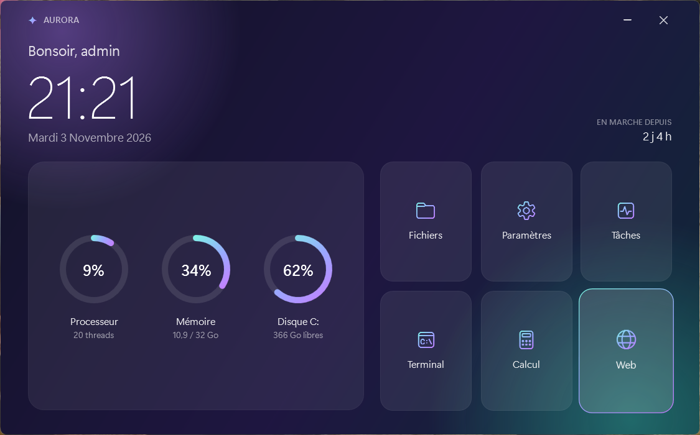

# ✦ Aurora

Tableau de bord élégant pour **Windows 10 et 11** : horloge, anneaux processeur / mémoire / disque et raccourcis rapides, sur fond Mica (Windows 11) teinté « aurore ».

Ultra léger : ~0,1 % d'un cœur au repos, rien ne tourne quand la fenêtre est réduite.

100 % natif (PowerShell + WPF) : **aucune installation**, rien à télécharger.

## Lancer

Double-cliquez sur **`Lancer Aurora.bat`**.

Ou depuis un terminal :

```powershell
powershell -STA -ExecutionPolicy Bypass -File .\Aurora.ps1
```

## Personnaliser

Les raccourcis sont les `<Button ... Tag="...">` dans `Aurora.ps1` : changez le `Tag` (programme, dossier ou URL), l'icône et le texte.


